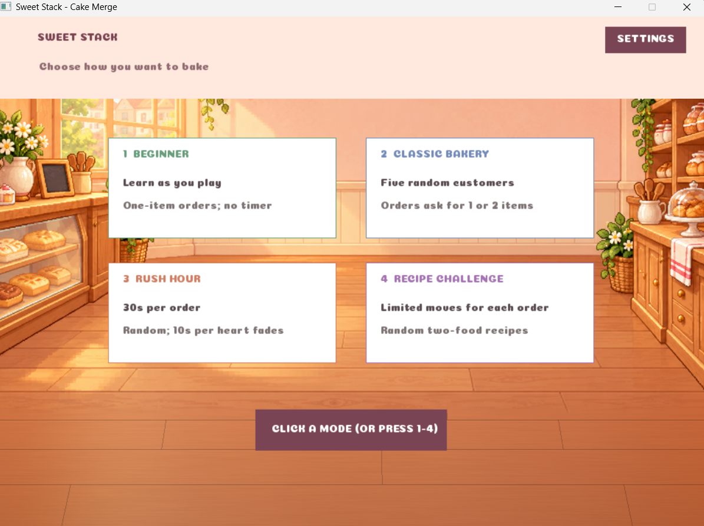
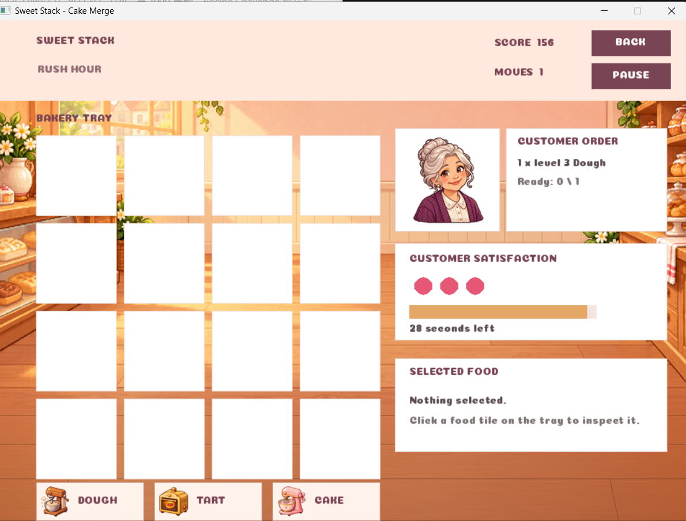
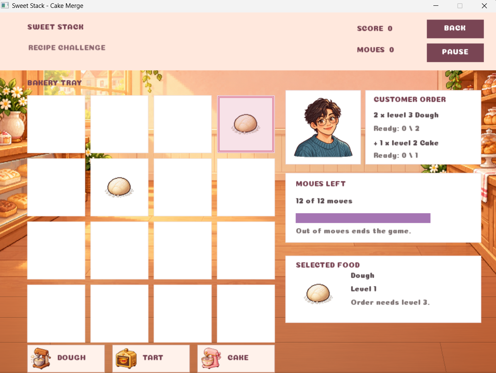
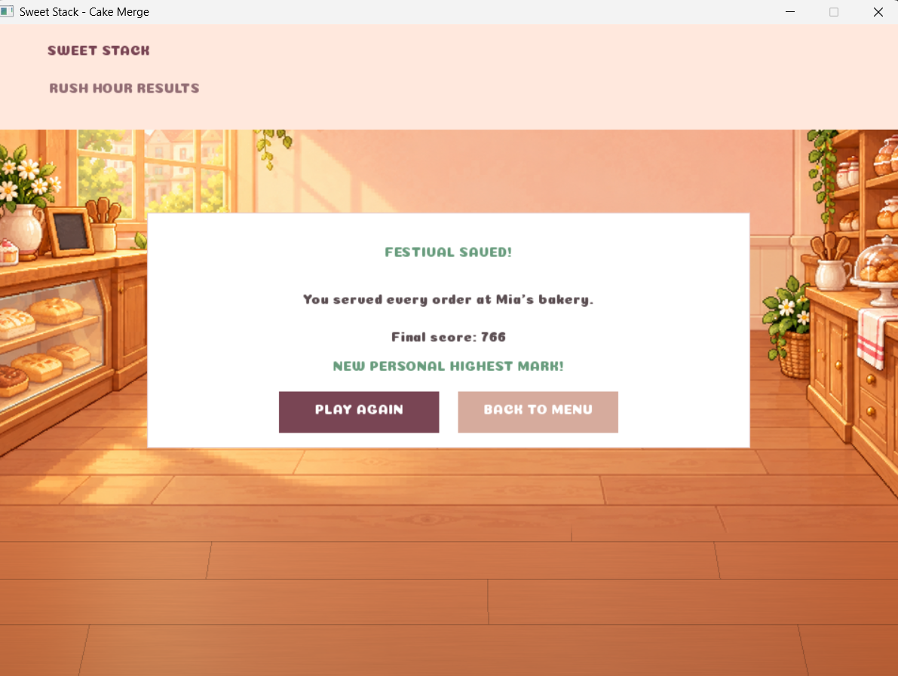

# Sweet Stack 🍰
Sweet Stack is a C++ bakery puzzle game built with SplashKit. Help customers by merging matching foods on a 4 × 4 board, completing their orders and keeping the bakery running.



## Features

- **Four game modes**
  - **Beginner** introduces the core merge mechanic with a fixed sequence of orders, no timer and on-screen guidance.
  - **Classic Bakery** challenges you to serve five customers with randomly generated orders and no timer.
  - **Rush Hour** gives you 30 seconds per order. A heart fades every 10 seconds, and completing an order early earns a time bonus.
  - **Recipe Challenge** asks you to complete two-food recipes within a move limit that increases from 12 to 16, then 20 moves per customer.
- **Merge and upgrade** dough, tarts and cakes through four levels. Only the exact food and level requested by an order will count.
- **Meet five festival customers**, each with their own portrait and randomly assigned orders in the non-Beginner modes.
- **Follow the story** with illustrated characters, subtitles and character dialogue audio.
- **Personal Highest Marks** are saved locally for Classic Bakery, Rush Hour and Recipe Challenge. Beginner uses a fixed learning sequence and does not track a mark.
- **Customise audio** with separate settings for background music and sound effects.
- **Pause, replay or return to the menu** from the game and results screens.

## Gameplay screenshots

### Rush Hour
Serve each customer before the timer runs out. Customer satisfaction fades as time passes.



### Recipe Challenge
Plan merges to complete both requested foods within the move limit.



### Results

Review the final score and Personal Highest Mark, then replay or return to the menu.


## How the game works

The board contains 16 squares. Use a food generator to add an item, then move items or merge two matching items into the next level. For example, two Level 1 dough items merge into Level 2 dough. Continue merging until you create the exact item requested by the customer.

An order can request more than one item. In Recipe Challenge, each completed requirement is counted separately and the delivered item is collected after the same one-second acknowledgement used for regular orders. Items of the wrong category or level do not satisfy the order.

### Scoring
- A merge awards **10 points per resulting level**: Level 2 gives 10 points, Level 3 gives 20, and Level 4 gives 30.
- Completing an order awards **100 × its order number**: the first order gives 100 points, the second gives 200, and so on.
- Rush Hour adds **2 points for each whole second remaining** when an order is completed.
- Moving or generating items does not award points.
- Classic Bakery, Rush Hour and Recipe Challenge save their highest scores to `high_scores.txt` in the project folder. The saved values are ordered Classic Bakery, Rush Hour, then Recipe Challenge.

## Technical implementation

- **C++11 and SplashKit:** the game uses SplashKit for window creation, input, drawing, bitmap and audio loading, random number generation, font rendering and timing. The Makefile links the game against SplashKit.
- **No separate text or UI library:** the interface loads the bundled `Resources/fonts/Coiny-Regular.ttf` with SplashKit's `load_font()` and draws labels with SplashKit's `draw_text()`. Coiny is a font asset, not a library. If that font cannot be loaded, the drawing code falls back to SplashKit's default text rendering.
- **Central game state:** `GameState` stores the 4 × 4 board, selected square, current mode, orders, score, timers, pause status and audio settings. Game modes and screen flow are represented with C++ enums, including story, mode selection, gameplay, win and game-over states.
- **Exact-match merge and order rules:** merging requires the same food category and tier. The result advances one level. An order requirement is counted only when both its category and requested tier match, and each requested item counts once.
- **Mode-specific order setup:** Beginner uses a fixed teaching sequence. The other modes shuffle the three food categories and generate requested tiers with SplashKit's `rnd()` function. Classic Bakery can request one or two items; Recipe Challenge can request multiple items of its first food plus a second food.
- **Timer-driven updates:** Rush Hour tracks elapsed time in milliseconds against a 30-second per-order limit and updates customer satisfaction as time passes. Recipe Challenge decrements a move counter after each board move or merge. Completed orders use timed customer-transition states before the next order begins.
- **Scoring and persistence:** merge points are calculated from the resulting tier, completed orders award a bonus based on their order number, and Rush Hour adds a remaining-time bonus. The score manager uses the C++ standard library's `<fstream>` to read and write `high_scores.txt`; it stores separate Personal Highest Marks for modes 2–4.
- **Modular source layout:** `game_state` sets up rounds, `game_logic` applies the rules, `game_view` renders screens, `input` handles controls, and the sound and score managers handle their respective tasks. `utilities` contains shared helper functions.

### Libraries and assets

- **External library:** SplashKit.
- **C++ standard library:** `<fstream>` is used for local high-score file input and output. The project does not use `iostream` or a separate text-rendering library.
- **Font asset:** Coiny Regular, loaded at runtime through SplashKit. Its licence is included at `Resources/fonts/Coiny-OFL.txt`.
- **Game assets:** bitmap artwork, background music, sound effects and story dialogue are loaded from `Resources/` through SplashKit.

## Controls

| Input | Action |
|---|---|
| Mouse click | Advance the story; choose a mode; use a generator; select, move or merge food; or press an on-screen button |
| `1`–`4` | Choose Beginner, Classic Bakery, Rush Hour or Recipe Challenge from the mode-selection screen |
| `Space` | Advance the story or return to mode selection from a results screen |
| `P` or `Esc` while playing | Pause or resume |
| `R` while playing or paused | Return to mode selection |
| `Esc` on the mode-selection screen | Close the Settings panel |
| Results-screen buttons | Choose **Play Again** or **Back to Menu** |

## Build and run

### Requirements

- C++11-compatible compiler (`clang++` is used by the Makefile)
- SplashKit installed and configured for the compiler
- GNU Make

Build and launch from the project folder so SplashKit can find the resources:

```bash
make
make run
```

To build and run the automated checks:

```bash
make test
```

To remove generated executables and test output:

```bash
make clean
```

## Project structure

```text
SweetStack/
├── Resources/
│   ├── audio/
│   ├── fonts/
│   └── images/
│       ├── customers/
│       ├── food/
│       └── readme/
├── src/
│   ├── game_layout.h
│   ├── game_logic.cpp
│   ├── game_logic.h
│   ├── game_state.cpp
│   ├── game_state.h
│   ├── game_view.cpp
│   ├── game_view.h
│   ├── input.cpp
│   ├── input.h
│   ├── main.cpp
│   ├── score_manager.cpp
│   ├── score_manager.h
│   ├── sound_manager.cpp
│   ├── sound_manager.h
│   ├── utilities.cpp
│   └── utilities.h
├── tests/
│   └── test_sweet_stack.cpp
├── .gitattributes
├── .gitignore
├── high_scores.txt
├── Makefile
├── README.md
└── SweetStack_Consolidated_Code.pdf
```
## Credits

- Built with **C++11** and **SplashKit**.
- **Coiny** font; see `Resources/fonts/Coiny-OFL.txt` for its licence.

**Author:** Ser Toh Yu Xin  
**Student ID:** 36818402  
**Unit:** FIT1045 Introduction to Programming